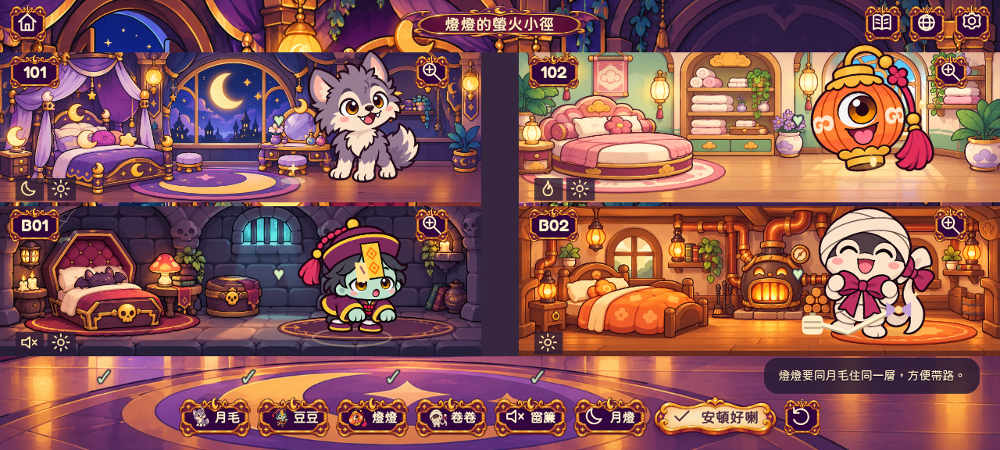
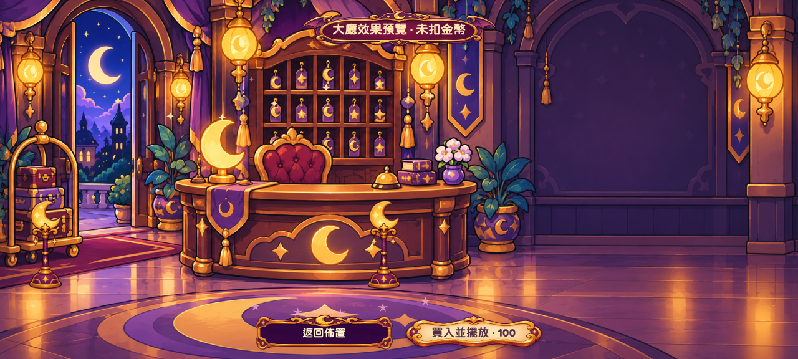
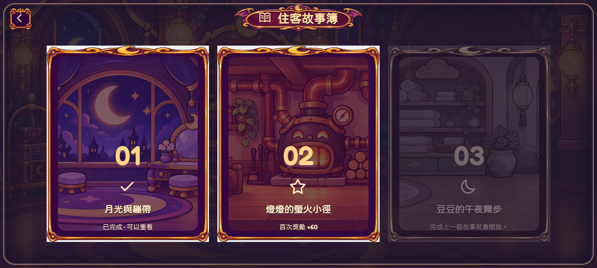

# 全螢幕酒店與三晚住客故事

這次把四間房由畫面中段的小橫條放大到主要遊戲區。房間高 160 設計單位，上下兩層由 y=56 延伸至 y=380，下方是有插畫的迎賓地板；不再用大片平色長方框當等候區。畫布伸延到螢幕四邊，按鈕另外留安全區。經測試發現較矮螢幕的入住按鈕曾遮住隊伍，現已把挑戰模式隊伍集中左下、入住和重設放右下。

英文及數字換成隨包附送的 Fredoka 圓體，房號加大；繁體中文使用本機圓體字集。所有角色待機、入房與演出都改用每格約 627×627 的動作圖，不再回到較細的舊待機圖。畫布支援最高 3 倍裝置像素，總像素上限 840 萬以免大型平板無限制耗記憶體。這些改善針對實際素材與渲染；並非把小圖假放大，也未聲稱已在所有 Android 手機驗證畫質或幀率。

## 佈置大廳

原本不清楚用途的「Decorate hotel」改稱「Lobby decorations／佈置大廳」。畫面明示：玩故事賺金幣 → 預覽真正大廳 → 買入並擺放。

- 可預覽三款原創插畫裝飾：月牙燈、絲絨地毯、星光屋徽。
- 預覽與取消不扣錢、不更動存檔；確認購買後才扣錢並立即擺放。
- 已買物品可收起及再次擺放，沒有重複收費。
- 顯示錢包、價格及每件裝飾放在哪裡；裝飾不會改變解謎規則。

## 三個可玩故事

大廳的「住客故事簿」可查看進度。依序完成上一晚便解鎖下一晚；每章可續玩自己的排房草稿、切換語言、近看房間、重看兩種結局。原有二十晚唯一解挑戰另外保留。

| 故事 | 排房重點 | 演出及選擇 | 首次收入 |
| --- | --- | --- | --- |
| 月光與繃帶 | 月毛怕缺月光，豆豆怕嘈；窗簾或換房 | 陪月毛玩／邀卷卷拉繩 | 50 |
| 燈燈的螢火小徑 | 燈燈與月毛同層，其他住客仍須滿意 | 跟螢火蟲走／四位一齊點星 | 60 |
| 豆豆的午夜舞步 | 豆豆與卷卷同層，需要搬月燈重新安排月毛 | 打拍子練習／四位一齊跳 | 75 |

後兩晚各有不同動畫、參與角色及道具；螢火迎賓燈、舞步星星會留在大廳。收入與首次結局一次記錄，重玩不會再派金幣或改寫首次好感。這是三晚故事及輕量熟客回饋，尚未加入完整餵食／育成經濟。

舊版第一晚的 `storyNight` 不變；新故事寫進可選 `stories[2]`、`stories[3]`。讀檔會忽略非法或未依序解鎖的故事，原本金幣、裝飾與二十關紀錄保留。草稿各自用 `.chapter-2`、`.chapter-3` 儲存，無須網絡。

驗證用排房示例（含解謎答案）

第二晚：月毛101、燈燈102、豆豆B01、卷卷B02。

第三晚：月毛B02、燈燈B01、豆豆102、卷卷101；把月燈放入B02。

## 實際遊戲預覽

[H.264 MP4](previews/expanded-stories.mp4) · [GIF](previews/expanded-stories.gif) · [915×412、3倍像素實際截圖](previews/expanded-retina-3x.png)

影片從已完成第一晚的測試存檔開始，實際操作第二、三晚並購買裝飾。錄影機使用 Canvas fallback，手機會按裝置支援選用 WebGL；不代表 Android 真機效能實測。

## 驗證結果

- `npm run build` 成功，115 個單元測試及 36 個完整瀏覽器流程通過。
- 正式編譯版本完成舊二十關、兩個新增故事的雙結局、每章續玩／重播防刷獎、儲存受阻時的當次進度、裝飾預覽取消與購買、英文及手機比例檢查。
- Android 1.1（versionCode 2）APK 已編譯；簽署有效，包內圖像、字體及編譯資源與測試中的 dist 相同。
- Android 手機實機的畫質、聲音、觸覺回饋與流暢度仍待測試。
