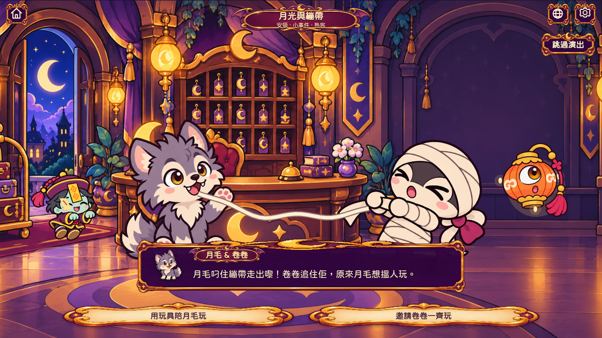
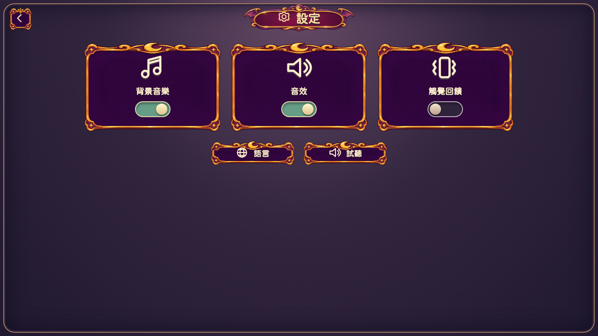
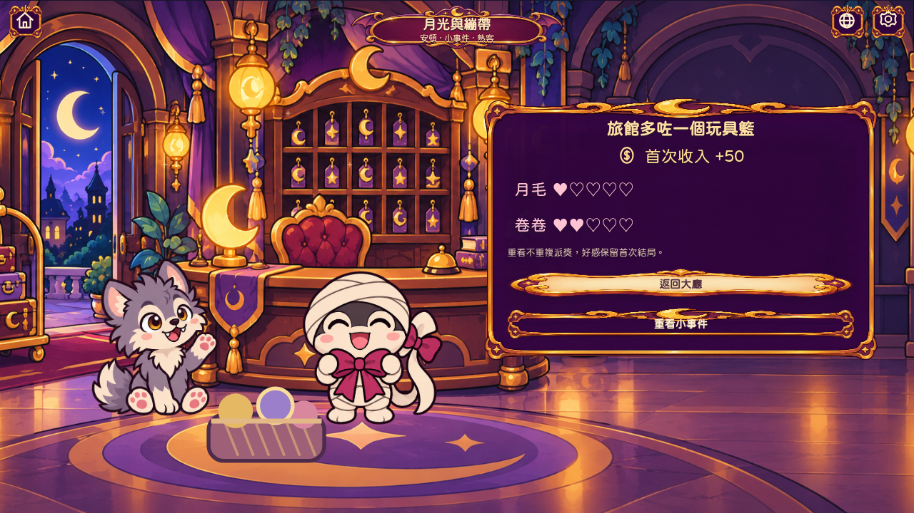

# 手機遊戲文字與介面修訂

把主要按鈕、房號、教學提示、故事對白、獎勵框，以及設定／語言／商店／關卡選擇換成同一套原創紫金插畫素材。封面繼續保持全幅插畫與獨立按鈕，沒有新增大框。

- 對白保留角色小像、名字牌及較大的圓體正文；更新演出文字時不會清走角色小像。
- 採用隨包附送、重新命名及縮小字集的 Huninn 圓體。Phaser 畫布與 HTML 觸控介面共用字款，啟動前載入字體與介面圖片，不需要外部字體服務。
- 圖框以九宮格切片適配不同畫面；文字保持正常比例，不會與背景一起拉闊。保留兩倍像素畫布、讀屏標籤、44px 以上的圖示操作區、減少動態設定。
- 新 UI 不改動故事選擇、兩種解法、首次獎勵、防重複派獎或原有 20 關與存檔。

介面原始圖片、來源說明與 SHA-256 見 `public/art/manifest.json`；字體授權見 `public/fonts/OFL-Huninn.txt`。日後加入新中文字，使用 `scripts/subset-ui-font.py` 重新生成字集；腳本會拒絕缺字的來源字體。

實際遊戲截圖與錄影（不是概念圖）：

[H.264 MP4](previews/native-ui-story-night.mp4) · [GIF](previews/native-ui-story-night.gif)

驗證結果：109 個單元測試、17 個相關瀏覽器測試全部通過。Android APK 簽署及包內 UI／字體／編譯資源與 dist 的位元組一致性亦已驗證。實際 MP4 為 H.264、GIF 共 120 個不同畫格。

重跑命令：`npm run build`、`npm test`、針對故事／設定／封面／大廳／教學／全螢幕的 Playwright 測試，以及 `npm run android:apk`。Android 真機手感仍需下載後測試，瀏覽器驗證不代表所有手機型號的實測結果。
