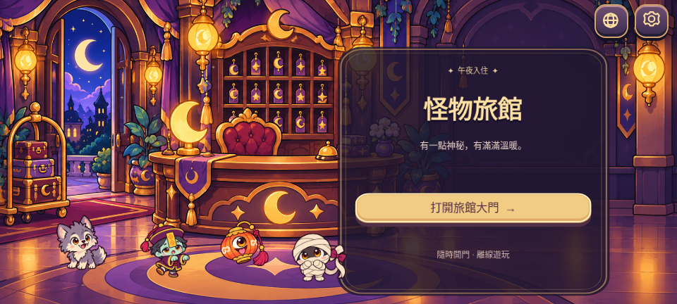
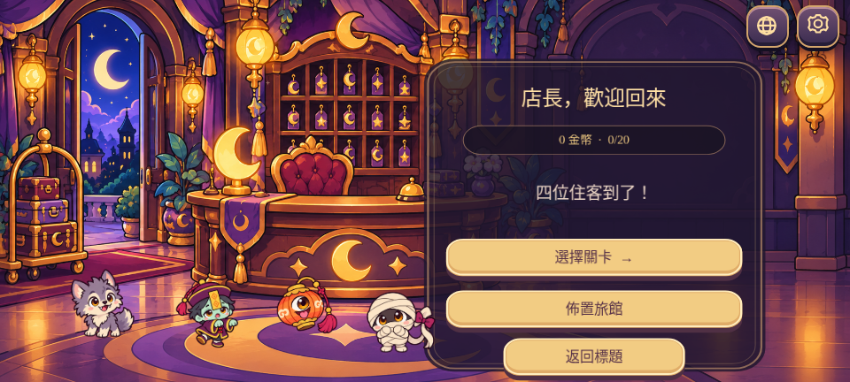

# 標題與前台大廳

標題及大廳使用新製作的原創酒店前台插畫，延續房間和四位住客的紫色輪廓、暖金色燈光及圓潤卡通造型。背景包含大門、行李、鑰匙櫃及接待桌；右方是簡短標題與大型操作掣。舊有簡單外牆圖形已移除。

四位住客仍使用遊戲原本的角色圖層，沒有畫死在背景內。點角色會顯示心心回應；系統「減少動態」會停用角色浮動及星光動畫。畫面保持全螢幕，背景按實際螢幕比例裁切，角色和文字保持原本比例。

大廳會顯示金幣及已完成晚數。選關、佈置、設定、語言及第一晚教學沿用原有功能。已擁有的月燈、絨地毯和星牌會顯示在前台，價格、儲存資料和擺放開關均保持相容。

`public/art/reception.png` 是由核准的角色與月光房間作風格參考生成的獨立原創背景；不含角色、文字或按鈕。原圖保留在雲端生成資料夾，專案只加入使用中的背景，SHA-256 記錄於素材 manifest。

## 實際示範

啟動 Vite 後，可執行 `node scripts/record-reception.cjs`，產生標題、大廳、選關及全裝飾截圖，以及 MP4／GIF 流程示範。錄影依賴及雲端工具路徑見 [教學示範說明](tutorial.zh-Hant.md)。

全裝飾截圖來自獨立、可丟棄的示範瀏覽器存檔（完成 12 晚、已購買三件裝飾），不會修改實際玩家的存檔。錄影頁面使用正常的 Canvas fallback，應用程式的 renderer 選擇沒有改動。

瀏覽器回歸涵蓋離線進入第一晚、英語切換、比例變更、角色招呼，以及原有佈置購買／隱藏／重載、教學及 20 關通關。這一輪沒有新增關卡、怪物或養成系統。

## 可直接在 GitHub 查看

為免聊天室的工作區下載連結失效，此輪選定的實際遊戲預覽亦保存在 `docs/previews/`，可直接由 GitHub 開啟：

[MP4 示範](previews/reception-walkthrough.mp4) · [GIF 示範](previews/reception-walkthrough.gif)
