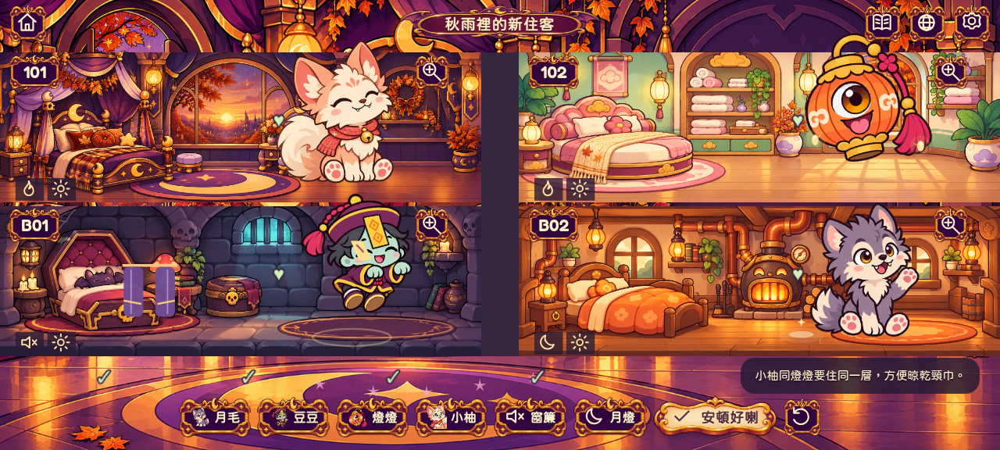
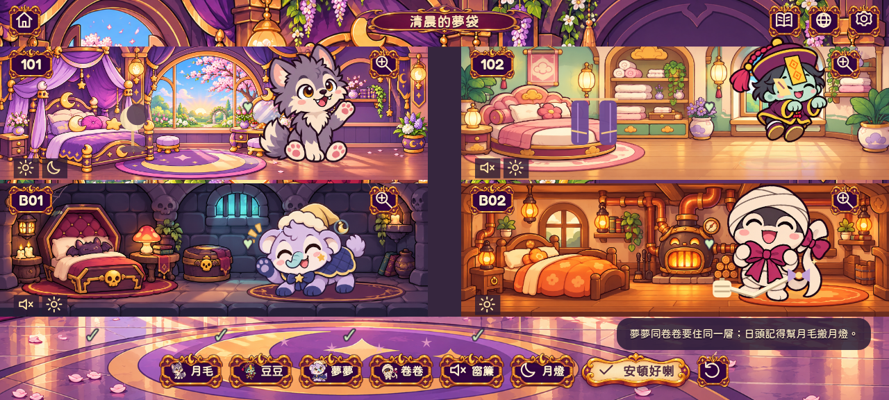
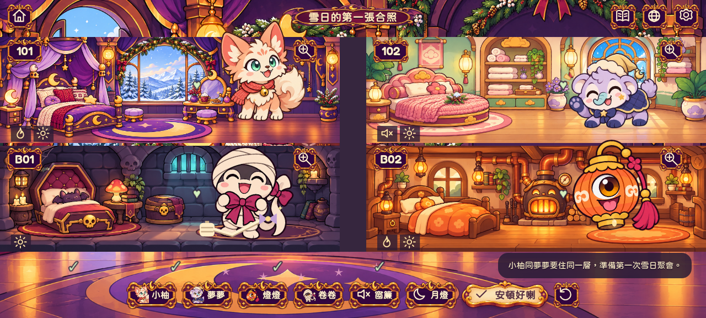
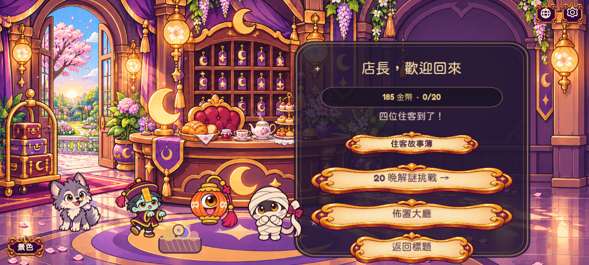

# 新住客與季節故事（1.2）

兩位新住客實際參與排房、房內動作、故事選擇與大廳熟客輪替。每章仍然只有四間房及四位當晚住客；原有月毛、豆豆、燈燈、卷卷，以及二十關唯一解挑戰保留。

| 角色 | 設計 | 入住心願 | 首次故事 |
| --- | --- | --- | --- |
| 小柚 Yuzu | 奶油桃色狐靈、蓬鬆尾巴、薄荷綠眼、珊瑚頸巾與金鈴 | 溫暖，想晾乾頸巾 | 第4章：秋雨裡的新住客 |
| 夢夢 Nemu | 淡紫食夢貘、青色小鼻、星星臉頰、睡帽與柔軟披肩 | 安靜，想整理夢袋 | 第5章：清晨的夢袋 |

兩位都是原創造型，以民間傳說為靈感；各有四格透明動作圖與獨立房內活動，不使用影視角色素材。

## 日夜及季節

大廳左下「景色」可免費選擇午夜星光、秋日黃昏、春日清晨、雪日午後；偏好離線儲存。背景是四套實際插畫，不是同圖轉色。秋暮、雪日的上層兩間房亦有對應窗外景色，清晨有新的日光套房。落葉、晨光微粒、雪花有輕量動態，減少動態設定仍適用。

故事的時段依劇情固定：第1～3章夜晚，第4章秋暮，第5章春晨，第6章雪日下午。手動選擇影響大廳及封面，不會令故事忽然由清晨變午夜。若沒有手動偏好，完成季節故事後，大廳會跟隨最新季節。

## 三個新增可玩章節

| 章節 | 特別排房要求 | 兩種互動 | 首次金幣 |
| --- | --- | --- | --- |
| 4 秋雨裡的新住客 | 小柚、燈燈同層；仍要處理月毛與豆豆的噪音 | 晾乾頸巾／一齊飲暖茶 | 80 |
| 5 清晨的夢袋 | 夢夢、卷卷同層；白天要幫月毛安排月燈 | 解開夢結／放走夢星 | 90 |
| 6 雪日的第一張合照 | 小柚、夢夢同層，為聚會做準備 | 合照劇情／砌雪朋友 | 100 |

現在共六個故事。各章可續玩、切語言、近看房間及重看兩種結局。首次結局／獎勵只記錄一次，重播不刷錢。合照是故事演出；尚未加入玩家可下載的相簿或完整育成系統。

故事簿有明確的前後頁操作。已完成前三章的玩家會直接見到新住客篇，毋須重新玩前三章。新篇完成後，大廳迎賓名單會出現對應新住客。

## 存檔兼容

維持版本1存檔及第一章 `storyNight`。`stories` 延伸到第6章，新增可選 `ambience`；非法或越序進度會被忽略。每章草稿仍獨立，新增角色只在自己的出場章節還原，舊金幣、裝飾與二十關紀錄不會清除。

測試解法（含答案）

- 第4章：小柚101、燈燈102、月毛B02、豆豆B01；窗簾放B01。
- 第5章：月毛101、豆豆102、夢夢B01、卷卷B02；月燈放101、窗簾放102。
- 第6章：小柚101、夢夢102、燈燈B02、卷卷B01。

## 實際遊戲示範

[實際操作 MP4](previews/seasons-guests.mp4) · [動畫 GIF](previews/seasons-guests.gif) · [3倍像素畫面](previews/seasons-retina-3x.png)

影片從已完成前三章的測試存檔開始，實際安排新章節並作出選擇，不是概念圖。錄影環境使用 Canvas fallback；Android 真機畫質、音效及流暢度仍需測試。

## 驗證

118 個單元測試通過；原有 36 項瀏覽器流程全部通過，最終故事簿再驗證新5項及舊11項故事流程（合計41個不同流程）。包含六章雙結局、續玩、重播不刷獎、景色保存、英文及舊存檔。APK 1.2（versionCode 3）已編譯並驗證簽署，包內所有公開素材、字體及編譯資源與測試中的 dist 逐位元組一致。示範影片為 H.264，GIF 有120個不同實際畫格；3倍像素截圖為2745×1236。
