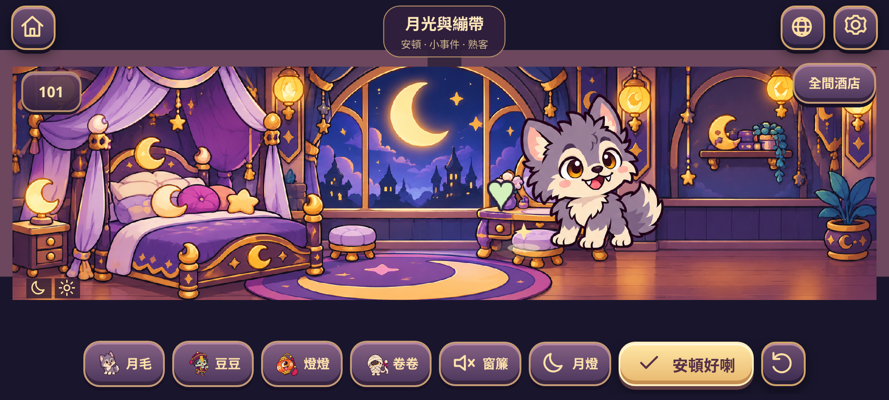

# 可玩故事夜：月光與繃帶

大廳新增「故事夜：月光與繃帶」。原有 20 晚唯一解關卡仍可由「20 晚解謎挑戰」進入，進度及金幣保持相容。

## 一晚的流程

四位住客排隊到達，點角色可看一句心願。先選角色再點房號，或直接拖入房間；已入住的住客也可以再拖動。房間右上角的放大鏡可看近鏡。

隔音窗簾與月亮燈各有一件，可以拖入房間，亦可選用品再點房號。用品可以移去另一間房，不會複製成多件。窗簾增加安靜條件、阻隔鄰房嚎叫；月亮燈增加月光條件。角色會即時顯示舒適或疑問反應，未隔音的嚎叫亦有聲波視覺提示。

「安頓好喇」會檢查四位住客的需求與鄰房噪音，並非只有一種答案。正確安排後，會進入狼人叼走繃帶、木乃伊追來的小事件。可以選擇陪狼人玩，或邀請木乃伊一起玩。兩條演出包括不同角色姿勢、走位、布帶曲線、玩具彈跳、影子及粒子反應；可跳過演出。系統減少動態偏好會直接顯示結果，不要求等待動畫。

首次完成這個故事夜，收入 50 金幣，解鎖大廳玩具籃；狼人會間中走去玩。陪狼人玩留下月毛 2／卷卷 1 的熟悉度，一起玩則是月毛 1／卷卷 2。結局畫面及大廳角色招呼會顯示這個關係結果。這是第一個故事夜的輕育成結果，未包含心意貨幣、完整送禮或 20 晚故事主線。

重看任一結局不會重複派金幣、增加熟悉度或改寫首次關係。故事收入與原有解謎首次通關獎勵分開計算。離線不扣數值，也沒有飢餓倒退或倒數壓力。

安頓解法示例（含提示）

| 方法 | 月毛 | 豆豆 | 燈燈 | 卷卷 | 用品 |
|---|---|---|---|---|---|
| 隔音 | 101 | 102 | B02 | B01 | 窗簾放 101 或 102 |
| 另一間月光房 | B01 | 102 | B02 | 101 | 月亮燈放 B01 |
| 另一間安靜房 | 101 | B01 | B02 | 102 | 窗簾放 B01 |

## 清晰度與動態

Phaser 畫布現在跟隨裝置像素密度，最高使用 2 倍像素；CSS 畫面尺寸維持全螢幕，觸控座標由 Scale Manager 正常換算。Phaser 文字亦按相同密度建立材質，避免只放大低密度文字。

原本角色圖集的透明邊在 runtime 以 frame 裁切，沒有把舊圖片重採樣扮成高清；角色顯示尺寸增大。新增四份獨立 1254×1254、2×2 原創姿勢圖集，每位四個姿勢，按透明像素邊界對齊腳底。房間近鏡可呈現既有高解像背景的細節。

房內活動現為姿勢切換配合程序動作：狼人蹲低／撲跳／揮手、殭屍完整三跳再休息、燈靈觀望／轉向／笑眼與火花環繞、木乃伊拉繃帶／捲好／展示蝴蝶結。這是 2D 姿勢及分段演出，沒有採用骨骼動畫系統。

## 儲存與測試

分房、用品及階段保存於獨立的 `midnight-check-in.story-night.v1` 草稿。原本 version 1 主存檔只新增可選的 `storyNight.outcome`；首次收入與結局透過同一次主存檔寫入。重玩以主存檔的故事標記防止重複領取。非法草稿不會直接跳入事件；讀寫失敗時可在當次繼續並有清楚提示。

本輪執行：109 項單元測試；完整 30 項瀏覽器回歸；圖集／畫質與動畫針對性覆檢；最後故事及大廳的 8 項覆檢。新增情境包含兩種安頓方式、兩條結局、用品拖動、真實 2× 畫布的角色拖動、語言及近鏡、重開恢復、重玩防重複獎勵、儲存被阻擋時保留當次進度。現在瀏覽器測試檔合共提供 31 個情境。

使用 `PLAYWRIGHT_BROWSERS_PATH=/workspace/.tooling/playwright node scripts/record-story.cjs` 可產生實際 1280×720 H.264 MP4、較小的 GIF 預覽，以及 960×432 CSS 像素下、1920×864 畫布的真實 2× 截圖。錄影頁面使用正常 Canvas fallback，避免雲端軟件 WebGL 擷取瓶頸。這不是實體 Android 效能測試，手機上的幀率、觸覺與音效仍需實測。

[720p MP4 示範](previews/story-night.mp4) · [GIF 預覽](previews/story-night.gif)
